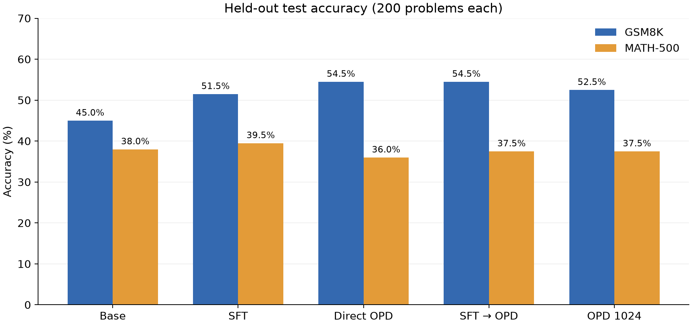
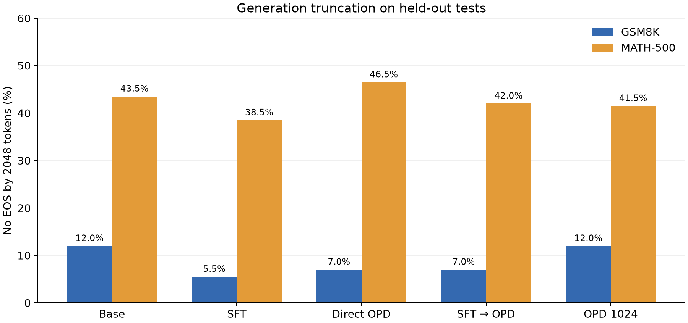

# Qwen3.5 数学推理后训练：SFT 与 On-Policy Distillation

在单卡资源约束下，以 Qwen3.5-0.8B 为学生、Qwen3.5-4B 为教师，比较教师轨迹 SFT、直接 OPD，以及 SFT 后继续 OPD 对数学推理的影响。所有模型统一采用 **non-thinking** 模式；测试题和配置固定后再做比较。

**核心问题：** 在相同学生模型和训练题下，直接 OPD 能否改善数学正确率？先进行 SFT 后再 OPD 是否有额外收益？教师有多强，学生又与教师相差多少？

**快速导航：** [模型能力与师生对比](#模型能力与师生对比) · [最终测试结果](#最终测试结果) · [实验设计](#实验设计) · [数据和文件](#数据和文件) · [复现](#复现) · [局限与下一步](#局限与下一步)

## 模型能力与师生对比

本项目使用官方指令模型 [Qwen3.5-0.8B](https://huggingface.co/Qwen/Qwen3.5-0.8B) 和 [Qwen3.5-4B](https://huggingface.co/Qwen/Qwen3.5-4B)，分别作为学生和教师。两者都是已有通用能力的模型；这里的 Base 指未经本项目训练的 0.8B 模型。模型卡中的官方基准可以了解通用能力，但其数据集、推理模式和生成预算可能不同，不能与本项目结果直接比较。

为检查教师是否适合提供监督，我们先从 GSM8K 验证集取出同样 50 道题，使用 non-thinking、每题一次采样、最大生成 1024 token。以下均为本项目实测：

| 模型 | 设置 | 正确数 / 50 | 正确率 | 未产生 EOS |
|---|---|---:|---:|---:|
| 4B 教师 | 训练前 | 45 | 90% | 1 |
| 0.8B 学生 | 训练前 | 33 | 66% | 7 |
| 0.8B 学生 | SFT，验证集选择的检查点 | 27 | 54% | 见逐题记录 |

教师在这次小样本检查中高出原始学生 24 个百分点，为其作为教师提供了初步依据；单次采样和小样本使差距存在不确定性。SFT 检查点使用完整 100 题验证集选出，上表 50 题属于该验证集，因此不能把它作为独立测试，也不应根据这个子集断言 SFT 必然使模型退步。

**蒸馏后与教师的差距：目前不能严谨量化。** 教师只在这 50 道验证题、1024 token 预算下评测；最终的蒸馏模型在另外的测试子集上以 2048 token 预算评测。教师没有在两个 200 题最终测试集上运行，因此不能把教师的 90% 与下面学生的 54.5% 相减，也不能声称学生达到教师的某个比例。下一步应冻结学生检查点，让教师和学生在相同的独立测试题、提示词、生成预算和采样设置下重新评测，并报告逐题配对差异。

上述教师及学生输出分别保存在 `results/v2/teacher-val50.jsonl`、`base-val50-1024.jsonl` 和 `sft-low-25-val.jsonl`；50 题的 ID 可与 `data/v2/val50.jsonl` 对照。



## 最终测试结果

| 组别 | 初始化与训练 | GSM8K（200） | MATH-500（200） |
|---|---|---:|---:|
| Base | 官方 Qwen3.5-0.8B | 45.0% | 38.0% |
| SFT | Base → 教师解答 SFT | 51.5% | 39.5% |
| Direct OPD | Base → OPD | **54.5%** | 36.0% |
| SFT → OPD | SFT → OPD | **54.5%** | 37.5% |
| OPD 1024 | Base → OPD，生成长度上限 1024 | 52.5% | 37.5% |

GSM8K 上，直接 OPD 相对 Base 提高 **9.5 个百分点**；基于题目的配对 bootstrap 95% 区间为 **[2.0, 17.0] 个百分点**。SFT 后追加 OPD 相对 SFT 为 **+3.0 个百分点，区间 [-4.0, 10.0]**：本次结果不足以确认追加 OPD 带来稳定收益。MATH-500 没有观察到明确提升，且各组 **38.5%–46.5%** 的生成未在 2048 token 内结束，解释时需要谨慎。

区间只反映这 200 道题的抽样不确定性；每组仅一次训练和一次采样评测，不覆盖训练随机性或多次生成波动。详细数值、验证集选点和局限见 [实验报告](docs/实验报告.md)。



## 实验设计

```text
GSM8K 训练题 500 ── Qwen3.5-4B 生成解答 ── 答案验证 ── 456 条 ── 长度筛选 ── 455 条 SFT
       │                                                      │
       └── 学生在线采样，教师对学生生成序列给出分布指导 ── OPD ─┴── SFT → OPD

GSM8K 验证题 100：选择检查点；GSM8K 测试题 200 + MATH-500 测试题 200：最终比较
```

- 教师生成只在训练题上进行；最终答案通过 `math-verify` 与标准答案比较。答案正确不保证每一步推理均正确。
- 使用 TRL `DistillationTrainer`，学生自行生成轨迹、教师提供指导；LoRA rank 16、alpha 32，作用于 q/v 投影。主要 OPD 轨迹上限 512，另做 1024 消融。
- SFT 比较两个学习率及多个检查点，采用验证集最高准确率选点；两条 OPD 路线各训练 250 步，从 50、125、250 步中分别选点。1024 消融沿用直接 OPD 选出的步数。
- 测试均按同一提示词、采样参数和最大输出 2048 token 运行；答案解析失败计错。未结束生成单独统计为截断，但如果已能解析正确答案仍可计对。

## 数据和文件

| 位置 | 内容 |
|---|---|
| `data/v2/train.jsonl` | GSM8K 训练题 500 条，用于教师生成及 OPD 提示词 |
| `data/v2/teacher_raw.jsonl` / `teacher_sft.jsonl` | 教师原始生成 500 条 / 最终答案验证通过的 456 条 |
| `data/v2/val.jsonl` | GSM8K 验证题 100 条，用于选择超参数和检查点 |
| `data/v2/gsm8k_test.jsonl`、`math500_test.jsonl` | 两个固定测试子集，各 200 条 |
| `data/v2/manifest.json` | 数据源 revision、抽样种子、文件哈希和去重说明 |
| `scripts/` | 教师生成、训练、评测、结果汇总与绘图脚本 |
| `adapters/` | 四个实际测试使用的 LoRA 权重 |
| `results/v2/` | 逐题预测、验证集输出、汇总表和环境快照 |
| `figures/` | 可由逐题结果重新生成的实验图 |

数据来自 [GSM8K](https://huggingface.co/datasets/openai/gsm8k) 与 [MATH-500](https://huggingface.co/datasets/HuggingFaceH4/MATH-500)。项目检查了训练题与验证/测试题的规范化精确重复；没有完成近重复检查，也无法排除基础模型预训练污染。

## 复现

训练时使用单张 48 GB vGPU、Python 3.12、PyTorch 2.8.0+cu128。先按 PyTorch 官方方法安装匹配 CUDA 的 PyTorch，再安装 `requirements.txt`；精确环境见 `results/v2/environment-freeze.txt`。模型默认从 Hugging Face 加载，可通过环境变量指定本地目录；模型版本写在训练和评测脚本中。

```bash
pip install -r requirements.txt
export STUDENT_MODEL=Qwen/Qwen3.5-0.8B
export TEACHER_MODEL=Qwen/Qwen3.5-4B

# 教师生成并验证训练答案；覆盖已保存的数据，请先备份
python scripts/make_teacher_sft.py
# SFT 两个候选；对检查点做验证集评测后选出低学习率第 25 步
python scripts/train.py sft --train-data data/v2/teacher_sft.jsonl --output runs/sft-low --steps 125 --save-steps 25 --lr 0.00005
python scripts/train.py sft --train-data data/v2/teacher_sft.jsonl --output runs/sft-high --steps 125 --save-steps 25 --lr 0.0002
# 主实验和长度消融
python scripts/train.py opd --train-data data/v2/train.jsonl --output runs/direct-opd --steps 250 --save-steps 25 --max-completion 512
python scripts/train.py opd --train-data data/v2/train.jsonl --start-adapter runs/sft-low/checkpoint-25 --output runs/sft-opd --steps 250 --save-steps 25 --max-completion 512
python scripts/train.py opd --train-data data/v2/train.jsonl --output runs/direct-opd-1024 --steps 250 --save-steps 25 --max-completion 1024

# 示例：固定评测设置；其他组替换 adapter 和数据路径，Base 省略 --adapter
python scripts/evaluate.py --adapter adapters/direct-opd --data data/v2/gsm8k_test.jsonl --output runs/direct-opd-gsm8k-test.jsonl --max-new-tokens 2048 --batch-size 8
# 下面两条直接读取仓库内的已保存结果，不需要 GPU
python scripts/report_v2.py
python scripts/plot_results.py
```

检查点评估使用相同脚本，SFT 验证最大生成 1024 token、OPD 验证为 2048 token，因此两阶段验证分数不能直接横向比较；最终测试均为 2048。采样生成受批次、硬件和软件版本影响，重跑数值可能变化。

## 局限与下一步

1. **师生最终测试缺失：** 按同一评测配置补跑教师，才能衡量蒸馏后的师生差距。
2. **生成截断：** MATH-500 未产生 EOS 的比例达到 38.5%–46.5%；可提高生成预算并检查截断样本。截断不必然代表错误，当前判分仍允许已出现的正确答案得分。
3. **统计稳定性：** 200 题、每组一次训练及单次生成，配对 bootstrap 只反映题目抽样误差；需要多个训练和生成种子。
4. **数据覆盖与污染：** 训练仅使用 GSM8K，近重复和预训练数据污染未系统排查；教师答案验证也不能保证每一步正确。

## 参考

- [Qwen3.5-0.8B](https://huggingface.co/Qwen/Qwen3.5-0.8B) · [Qwen3.5-4B](https://huggingface.co/Qwen/Qwen3.5-4B)
- [TRL On-policy Distillation 文档](https://huggingface.co/docs/trl/main/en/distillation_trainer)
- [On-Policy Distillation of Language Models](https://arxiv.org/abs/2306.13649)
