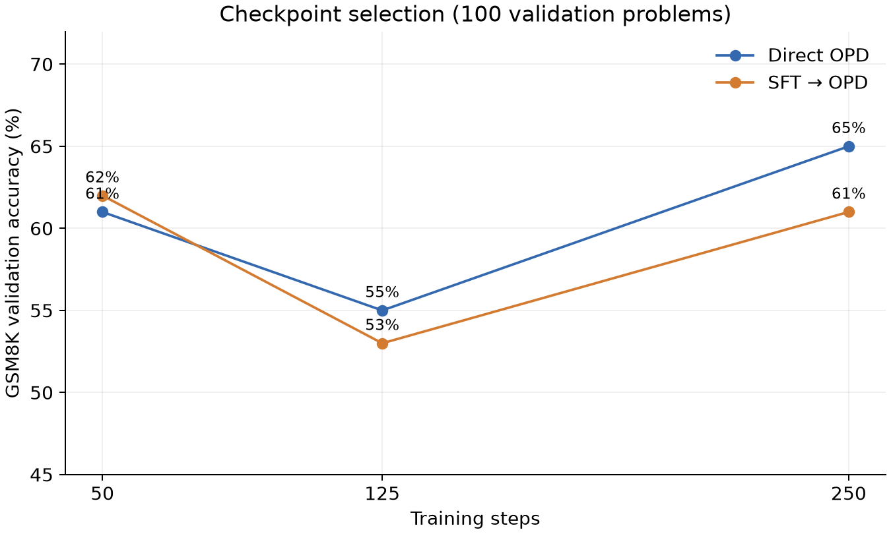

# 数学推理后训练实验报告

## 问题与实验控制

实验考察同一学生模型在有限 GSM8K 训练题上，教师解答监督微调与学生自采样的 on-policy distillation 的效果，重点比较直接 OPD 与 SFT 后追加 OPD。模型为 Qwen3.5-0.8B，教师为 Qwen3.5-4B；两者采用 non-thinking。采样提示要求分步求解并用 `\\boxed{}` 给出最终答案。

训练题 500、验证题 100 均来自 GSM8K 训练分区。测试为 GSM8K 和 MATH-500 各 200 题，固定在 `data/v2/`，题目 ID、源版本、SHA-256 见清单。训练与验证/测试之间做了规范化精确文本去重，未做语义近重复检测；预训练污染未知。教师 500 个解答中 456 个通过结束标记与最终答案验证，SFT 在 1024 token 长度约束下使用 455 条。教师质量筛选只验证最终答案。

## 训练与选点

- 单卡 48 GB vGPU，bf16、LoRA rank 16 / alpha 32，q_proj 和 v_proj；microbatch 1、梯度累积 4。
- SFT：学习率 2e-4 和 5e-5，各训练 125 步，在 25、50、125 步验证；验证输出上限 1024。高学习率对应正确数 53、55、56；低学习率为 60、58、57。选低学习率 25 步。
- OPD：学习率 1e-5，最多 250 步，学生采样上限 512，温度 0.7、top-p 0.95，`beta=1.0`，使用 TRL DistillationTrainer。验证上限 2048；Direct OPD 在 50、125、250 步正确数为 61、55、65，选 250；SFT → OPD 分别为 62、53、61，选 50。
- 额外消融：从 Base 做 1024 token OPD，训练 250 步，与直接 OPD 其他设置一致。该步数继承 512 token 组的选择，不是对 1024 组单独最优选点。
- 训练耗时：两个 SFT 全程各约 2.5 分钟；Direct OPD 约 54.8 分钟、SFT → OPD 约 48.1 分钟、1024 消融约 78.6 分钟。它们不包括教师生成、验证、测试、安装和下载。

不同阶段验证生成上限不同，不能用来直接比较 SFT 与 OPD 分数。所有最终测试统一 2048 token、batch 8、温度 0.6、top-p 0.95、top-k 20，seed 42；每题一次采样。答案用 `math-verify` 解析和判分，解析失败计错。截断定义为生成 token 未出现 EOS；截断结果仍可在答案可解析且正确时得分。

## 最终测试

| 组别 | GSM8K 正确率 | MATH-500 正确率 | GSM 截断率 | MATH 截断率 | GSM 平均 token | MATH 平均 token |
|---|---:|---:|---:|---:|---:|---:|
| Base | 45.0% | 38.0% | 12.0% | 43.5% | 640.8 | 1292.2 |
| SFT | 51.5% | 39.5% | 5.5% | 38.5% | 507.6 | 1232.0 |
| Direct OPD | 54.5% | 36.0% | 7.0% | 46.5% | 559.2 | 1314.5 |
| SFT → OPD | 54.5% | 37.5% | 7.0% | 42.0% | 539.4 | 1264.2 |
| OPD 1024 | 52.5% | 37.5% | 12.0% | 41.5% | 634.7 | 1276.9 |

| 配对差异，百分点 | GSM8K：估计值 [95% CI] | MATH-500：估计值 [95% CI] |
|---|---:|---:|
| Direct OPD − Base | +9.5 [+2.0, +17.0] | −2.0 [−8.0, +4.0] |
| SFT − Base | +6.5 [−1.0, +13.5] | +1.5 [−4.5, +7.5] |
| SFT → OPD − SFT | +3.0 [−4.0, +10.0] | −2.0 [−8.5, +4.5] |
| SFT → OPD − Direct OPD | 0.0 [−7.0, +7.5] | +1.5 [−4.5, +7.5] |
| OPD 1024 − Direct OPD | −2.0 [−9.0, +5.0] | +1.5 [−4.0, +6.5] |

区间为按同一题目配对重采样 5000 次的百分位 bootstrap 区间，未计入独立训练或推理多次采样的波动。直接 OPD 在本次 GSM8K 样本上的改善较明显；SFT 后再 OPD 的额外收益，以及 OPD 轨迹长度消融的差异，区间都包含零，不能据此断言优劣。MATH 截断比例较高，且训练数据只来自 GSM8K，当前实验不能支持跨分布数学能力普遍提升的结论。

## 可复现性边界

模型 revision 固定在训练脚本中，数据 SHA 固定在清单中，所有模型逐题输出和选定 LoRA adapter 均随项目保存。完整训练日志、优化器及全部中间检查点保存在本地完整备份。GPU、库版本和采样批次变化可能改变生成结果。下一步若需更可靠结论，应先对 MATH 增大输出预算并复核截断，再使用多个训练种子/生成种子和更多题目确认；不应根据当前单次运行夸大收益。
